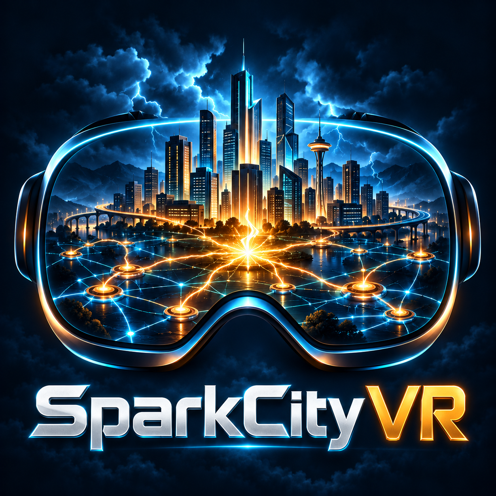
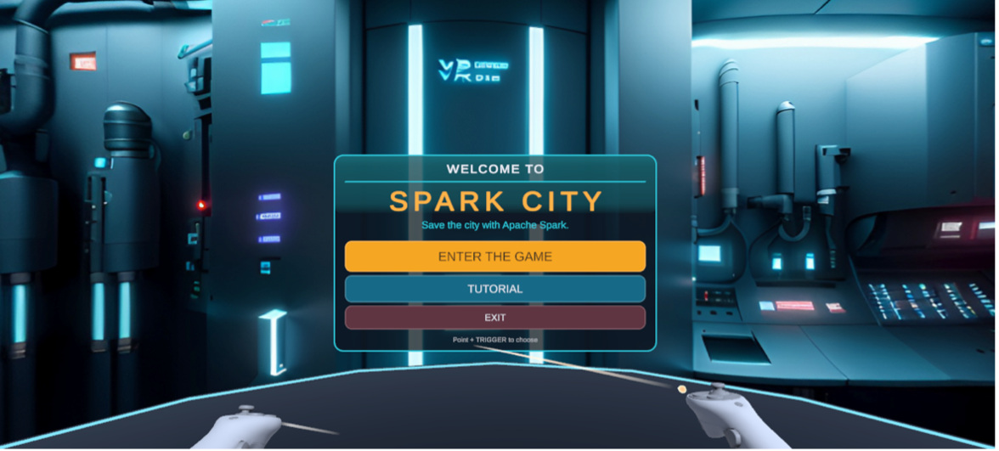
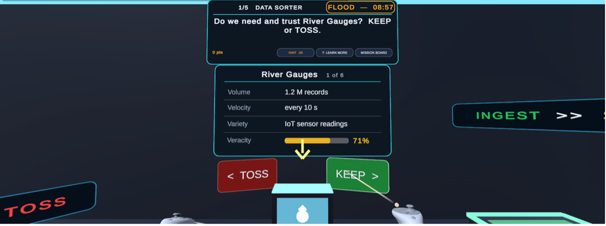

<p align="center">
  
</p>

<h1 align="center">SparkCity VR</h1>

<p align="center">
  <strong>Build reliable data pipelines. Make critical decisions. Protect the city.</strong>
</p>

<p align="center">
  An immersive educational game for Meta Quest 3S exploring Apache Spark,
  data reliability, and human oversight during smart-city emergencies.
</p>

<p align="center">
  
  
  
  
</p>

<p align="center">
  <a href="#gameplay">Gameplay</a> ·
  <a href="#getting-started">Getting Started</a> ·
  <a href="#classroom-use">Classroom Use</a> ·
  <a href="#project-and-acknowledgments">Project</a>
</p>

## Overview

SparkCity VR places students in charge of a smart city's data-processing system during two emergencies. Players select sources, clean records, assemble a processing pipeline, troubleshoot a cluster, and decide whether the resulting evidence is reliable enough to support an emergency response.

Earlier choices carry forward into the final report. Unreliable data can lead to an incorrect evacuation; a clean, timely, verified result supports a safer response. The learning goal is to connect Spark concepts with the consequences of acting on processed data.

**Two missions · Seven mini-games · Approximately 14 minutes of core gameplay**

> Spark operations, datasets, failures, and outcomes are simulated locally through predefined Unity rules. Gameplay does not require a running Spark cluster or an external data-processing service.

<p align="center">
  
</p>

## Learning Objectives

The game connects Spark fundamentals with practices that support trustworthy analytics and AI.

| Learning area | Player activity |
| --- | --- |
| Data quality and provenance | Assess source relevance and reliability; identify duplicates, missing values, invalid types, and corrupted records. |
| Execution transparency | Assemble transformations, trigger an action, and inspect the resulting processing workflow. |
| Distributed processing | Observe drivers, executors, and partitions; diagnose uneven workloads and apply a corrective strategy. |
| Streaming reliability | Explore event-time windows, late data, watermarks, and checkpoint recovery. |
| Human oversight | Review processing evidence before approving, rejecting, or rerunning an emergency recommendation. |

## Gameplay

### Mission 1 — Flood Warning

A flood threatens the city. Players must produce a reliable district-level warning before the emergency escalates.

| Mini-game | Player task | Concepts |
| --- | --- | --- |
| **Data Sorter** | Keep sources that are relevant and sufficiently reliable. | Volume, velocity, variety, veracity |
| **Clean-Up Blaster** | Match problematic records with an appropriate cleaning operation. | `dropDuplicates()`, `dropna()`, `cast()`, quarantine handling |
| **Lazy Pipeline** | Assemble a workflow and choose the action that executes it. | Transformations, actions, lazy evaluation |
| **Balance the Cluster** | Identify and correct an uneven distribution of work. | Driver, executors, partitions, skew, repartitioning |
| **Trust Check** | Inspect the final report and approve, reject, or repair and rerun. | Output validation, accountability, emergency decisions |

A **10-minute flood countdown** creates urgency. Mistakes consume time, earlier decisions affect the final report, and the city map displays the consequence of the final decision.

### Mission 2 — Rush Hour Stream

Traffic information arrives continuously. Players must handle late events and protect streaming progress against an application crash.

| Mini-game | Player task | Concepts |
| --- | --- | --- |
| **Window Catcher** | Compare lateness thresholds and their simulated effect on the traffic result. | Event time, windows, watermarks, late data |
| **Crash Recovery** | Choose a recovery strategy for a restarted streaming application. | Durable checkpoints, query state, fault recovery |

Each mini-game concludes with a short **REMEMBER** card reinforcing its central lesson.

<p align="center">
  
</p>

## Features

- **Consequence-driven learning:** source, cleaning, and pipeline decisions influence the final mission report.
- **Immersive presentation:** a panoramic welcome environment, procedural rooms, interactive stations, and visual effects.
- **Simple interaction:** point-and-trigger controls with seated play support.
- **Contextual guidance:** optional tutorial cards, hints, and explanations available during play.
- **Comfort features:** fade transitions, recentering, and a restrained sound mix.
- **Desktop testing:** mouse-and-keyboard interaction in the Unity Editor.
- **Editable content:** mission text, datasets, answer definitions, and feedback stored in JSON.

## Requirements

| Component | Requirement |
| --- | --- |
| Unity Editor | **6000.3.21f1** |
| Build tools | Android Build Support, including OpenJDK, Android SDK, and NDK |
| Target headset | Meta Quest 3S; Quest 3 is also supported |
| Headset deployment | Developer mode enabled and a USB-C data cable |
| Unity packages | XR Interaction Toolkit **3.3.2** with Starter Assets, OpenXR Plugin, Universal Render Pipeline, Input System, and TextMeshPro |

Use the package versions recorded in `Packages/manifest.json` and `Packages/packages-lock.json`.

## Getting Started

1. Clone or download the repository.
2. In **Unity Hub**, choose **Add → Add project from disk** and select the project folder.
3. Open the project using the Unity version listed above and allow package imports to finish.
4. Open `Assets/SparkCityVR/Scenes/SparkCity.unity`.
5. If the generated scene or materials are missing, select **Spark City VR → Build Game Scene**.
6. Press **Play**.

Desktop test mode activates in the Editor when no active headset or XR simulator is detected.

| Input | Action |
| --- | --- |
| Mouse | Aim the controller ray |
| Left click | Activate the pointed button |
| Right drag, arrow keys, or Q/E | Look around |
| W/A/S/D | Move |
| F | Toggle a wider field of view |

## Build for Meta Quest

1. Select **Spark City VR → Configure Quest Build Settings** to configure the Android target, IL2CPP, ARM64, and Linear color space.
2. Under **Project Settings → XR Plug-in Management → Android**, enable **OpenXR** and the **Meta Quest** feature group.
3. Review **Project Validation** and resolve the reported configuration issues.
4. Connect the headset and accept the USB debugging prompt inside the headset.
5. Open **File → Build Profiles**, select the Android/Quest build profile and connected headset, then choose **Build And Run**.
6. Launch the installed application from **Library → Unknown Sources**, if necessary.

## Project Structure

```text
Assets/SparkCityVR/
├── Scripts/
│   ├── Runtime/                  Missions, UI, world generation, and desktop controls
│   └── Editor/                   Scene generation and Quest build tools
├── Resources/
│   ├── SparkCityData/
│   │   ├── content.json           Mission content and answer definitions
│   │   └── tutorial.json          Tutorial cards
│   ├── SparkCityArt/              Welcome artwork
│   ├── SparkCityFonts/            Optional heading and body fonts
│   └── SparkCityMaterials/        Generated material assets
└── Scenes/
    └── SparkCity.unity

Docs/
├── Images/                       Project icon
├── Screenshots/                  Welcome and gameplay images
├── SETUP_GUIDE.md
└── TEACHER_GUIDE.md
```

## Customization

**Mission content:** edit `Assets/SparkCityVR/Resources/SparkCityData/content.json` to update source descriptions, dirty records, pipeline blocks, reports, answers, and feedback. Existing content fields can be changed without modifying C#; new mechanics require corresponding code changes.

**Tutorial:** edit `Assets/SparkCityVR/Resources/SparkCityData/tutorial.json`.

**Welcome artwork:** place the selected image in `Assets/SparkCityVR/Resources/SparkCityArt/` as `welcome.jpg` or `welcome.png`. Select the appropriate **Welcome Art Mode** on the `SparkCityGame` component. Panorama mode requires an equirectangular image.

**Visual theme:** shared palette definitions are maintained in `Assets/SparkCityVR/Scripts/Runtime/Visuals.cs`.

See the [Setup Guide](Docs/SETUP_GUIDE.md) for additional configuration details.

## Classroom Use

The game is designed to fit a **30-minute classroom session**.

| Activity | Suggested time |
| --- | --- |
| Headset fitting and controls | 5 minutes |
| Optional tutorial | 3 minutes |
| Mission 1 | 10 minutes |
| Mission 2 | 6 minutes |
| Discussion and reflection | 6 minutes |

Suggested discussion prompts:

- How can duplicated or unreliable records change an emergency recommendation?
- Why does assembling transformations not immediately execute the pipeline?
- What trade-offs arise when handling late streaming events?
- What evidence should a person inspect before approving a recommendation?

See the [Teacher Guide](Docs/TEACHER_GUIDE.md) for the answer key and facilitation notes.

## Project and Acknowledgments

Developed by **Sumit Barua**, Graduate Research Assistant in Computer Science at **Western Michigan University**, under the supervision of **Prof. Alvis Fong**.

SparkCity VR contributes to the NSF-funded project **Promoting AI Readiness for Machine-Assisted Secure Data Analysis (PAIR4MASDA)**, supported under [NSF Award OAC-2320951](https://www.nsf.gov/awardsearch/show-award?AWD_ID=2320951).

Any opinions, findings, conclusions, or recommendations expressed in this material are those of the author and do not necessarily reflect the views of the National Science Foundation.

## Credits

- **Development tools:** Unity, XR Interaction Toolkit, OpenXR, and Universal Render Pipeline.
- **Project icon:** custom AI-generated artwork created for SparkCity VR.
- **Welcome artwork:** attribution and reuse terms depend on the selected panorama.
- **Optional fonts:** Orbitron and Exo 2; retain the license files distributed with any fonts included in the repository.

<!-- Before publishing, replace the welcome-artwork credit with the actual creator, source URL, and license. -->

## License

A repository-wide license has not yet been specified. Third-party artwork, fonts, and dependencies remain subject to their respective licenses.

<!-- Once a license is selected and added at the repository root, replace the paragraph above with its name and a link to LICENSE. -->

